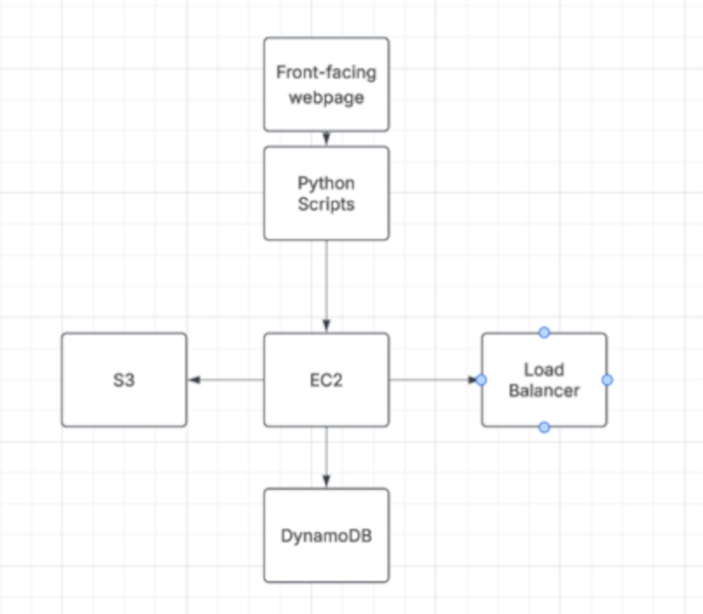

# AWS-Final-Project
Repo for my AWS Final Project - Anonymous Message Board

To install this application:
1. Set up S3 bucket with index.html, banner.jpg, messages.py, and post_message.py.
2. Use cs79c-stack.yaml to create a new stack in CloudFormation.
  This will build the ec2 instance and dynamoDB.
3. SSH into EC2 instance. Copy index.html and banner.jpg into /var/www/html using aws s3 cp <s3 URI> <filename>
4. From EC2, navigate to var/www/ and create director cgi-bin. In cgi-bin, and copy both python files into /cgi-bin as above.
5. Run the following commands from the EC2 terminal:
   
    sudo yum update -y
    sudo yum install python3-pip -y
    pip3 install boto3 
    
6. Return to EC2 dashboard.
7. Create a DynamoDB table named "CS79C_TABLE" with "MessageId" as
8. Add Load Balancer as needed.
9. Open the EC2 instance and open the Public iPV4 address. Ensure you are on http and not https.

Video demo / walkthrough:
https://youtu.be/BzeJfPc5z24

